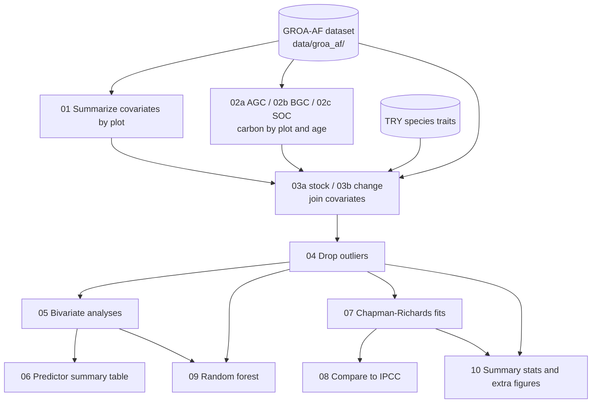

# Agroforestry carbon analysis code

Analysis code supporting:

> Manuscript under review at *Nature Communications*; the full citation will be added on publication.

The analysis uses the GROA-AF (Global Reforestation Opportunity Assessment:
AgroForestry) database of plot-level carbon measurements to estimate
aboveground carbon (AGC), belowground carbon (BGC) and soil organic carbon
(SOC) stocks and accumulation rates across agroforestry system types and
climate regions. It fits Chapman-Richards growth curves, compares the
results with IPCC Tier 1 defaults, and uses random forest models to identify
drivers of carbon storage.

## Repository structure

```
.
├── notebooks/            R Markdown notebooks, numbered in run order
├── data/                 Input data (see data/README.md)
│   └── groa_af/          The GROA-AF dataset: studies, sites, measurements + metadata (CSV)
├── output/
│   ├── data/             Plot-level carbon-by-age datasets (*_by_plot_and_age*.xlsx; notebooks 02a/02b, 03a/03b, 04)
│   ├── intermediate/     Other pipeline intermediates and the RF/SHAP cache (not tracked; regenerated)
│   ├── tables/           Final tables reported in the paper / SI
│   └── figures/          Final figures
├── citations/            BibTeX entries for R and key packages
├── run_all.R             Runs the full pipeline (notebooks 01 -> 10)
└── renv.lock             R package versions
```

## Pipeline



| Notebook | Description | Main outputs |
|---|---|---|
| `01_summarize_covariates_by_plot` | Summarizes non-carbon covariates from the measurements table to one row per plot. | `s3_by_plot.xlsx` |
| `02a_agc_by_plot_and_age` | AGC stock and change rate per plot and stand age. | `agc[_change]_by_plot_and_age.xlsx` |
| `02b_bgc_by_plot_and_age` | BGC stock and change rate per plot and stand age (with depth handling). | `bgc[_change]_by_plot_and_age.xlsx` |
| `02c_soc_by_plot_and_age` | SOC stock harmonized to a common depth (30 cm by default), compared with control/reference values to give ΔSOC and rate of change. | `soc_data_out_c_t_ha_norm_30.xlsx` |
| `03a_join_c_stock_covariates` | Joins carbon stocks with plot covariates, site covariates (climate, elevation, SoilGrids texture, ecoregion) and species traits. **Run once per pool** (`c_data_name` = `agc`, `bgc`, `soc`). | `*_by_plot_and_age_w_covars.xlsx` |
| `03b_join_c_change_covariates` | Same as 03a for carbon change rates. **Run once per pool** (`agc_change`, `bgc_change`, `soc_change`). | `*_change_by_plot_and_age_w_covars.xlsx` |
| `04_drop_outliers` | Final post-processing: IQR outlier removal, drops age-0 rows and uninformative binary columns. | `output/data/*_w_covars_drop_outliers.xlsx` (final analysis datasets) |
| `05_bivariate_analysis` | Descriptive figures and bivariate models of each carbon pool vs. each predictor. | `bivariate_model_summaries.*`, descriptive figures |
| `06_predictor_summary_table` | Predictor summary table (source, completeness, bivariate fit). | `predictor_summary_table.*` |
| `07_chapman_richards_fits` | Chapman-Richards growth curves of AGC and ΔSOC vs. age by ecoregion x agroforestry category, with bootstrap CIs, alongside the observed mean annual change rate per partition. | `{agc,soc}_cr_fit_table[_filtered].xlsx`, C-R figures |
| `08_compare_to_ipcc` | Compares AGC stock at maturity and growth rate with IPCC (2019) Tier 1 defaults. | `groa_ipcc_df.csv`, `groa_vs_ipcc_c_stock_growth_panel.png`, `{agc,soc_delta}_rate_comparison_by_method.png` (C-R vs. observed vs. IPCC rates) |
| `09_random_forest` | Random forest models of AGC and ΔSOC with SHAP interpretation and PDPs of the top predictors (ranked by grouped mean \|SHAP\|); test performance over 50 random train/test splits (the values reported in the paper). | `rf_*.csv`, `rf_*.png` |
| `10_summary_stats_and_extra_figures` | Numbers reported in the text, supplementary tables, the C-R parameter illustration, the category x ecoregion matrix, and site-level data for the map. | see notebook header |

Each notebook starts with a header listing its exact inputs and outputs.

## Manuscript figures and tables

| Manuscript | File | Notebook |
|---|---|---|
| Fig. 2 | `output/figures/c_density_by_age_panel.png` | 05 |
| Fig. 3 | `output/figures/rf_shap_beeswarm.png` | 09 |
| Fig. 4 | `output/figures/rf_pdp_top6.png` | 09 |
| Fig. 5 | `output/figures/agc_cr_fit_by_er_all_af_cat_panel_boot.png` | 07 |
| Fig. 6 | `output/figures/groa_vs_ipcc_c_stock_growth_panel.png` | 08 |
| Fig. 7 | `output/figures/c-r_curve_example_fig.png` | 10 |
| Fig. S1 | `output/figures/age_density.png` | 05 |
| Fig. S2 | `output/figures/c_by_age_scatter_panel.png` | 05 |
| Fig. S3 | `output/figures/c_by_ecoreg_violin_panel.png` | 05 |
| Fig. S4 | `output/figures/c_by_cat_violin_panel.png` | 05 |
| Fig. S5 | `output/figures/rf_model_diagnostics.png` | 09 |
| Fig. S6 | `output/figures/soc_delta_cr_fit_by_er_all_af_cat_panel_boot.png` | 07 |
| Table 1 | `output/tables/predictor_summary_table.xlsx` | 06 |
| Table S3 | `output/tables/agc_cr_fit_table.xlsx` | 07 |
| Table S4 | `output/tables/soc_cr_fit_table.xlsx` | 07 |
| Random forest performance (text) | `output/tables/rf_model_performance_summary.csv` | 09 |

Fig. 1 (site map) is based on the site locations in `output/tables/sites_with_*_for_map.csv` (notebook 10).
Fig. S7 (PRISMA diagram) and Tables S1–S2 (previous reviews; category definitions) are not produced by this code.
Other files in `output/` are supporting results (e.g., C-R fits by category, rate comparisons, top-9 PDPs, SHAP interactions).

## Reproducing the analysis

1. Clone this repository and open `agroforestry_carbon_analysis_code.Rproj`
   in RStudio (or set the working directory to the repository root; all
   paths are resolved with `here::here()`). The GROA-AF dataset is included
   in `data/groa_af/` (see [data/README.md](data/README.md)).
2. Restore the R package environment (developed with R 4.3.2):
   ```r
   install.packages("renv")
   renv::restore()
   ```
3. Run the full pipeline from the repository root:
   ```r
   source("run_all.R")          # or, from a shell: Rscript run_all.R
   ```
   This renders every notebook in order in a fresh environment (03a and 03b
   once per carbon pool), writes HTML reports to `output/intermediate/html/`,
   and stops at the first error. A full run takes about 4.5 hours, mostly
   in notebook 09 (about 50 minutes with `--use-cache`). `--from=05` resumes at a given notebook if earlier
   intermediates exist; `--skip=09` leaves out notebooks. Notes:
   - `03a` and `03b` process one carbon pool per run, selected by the
     `c_data_name` YAML parameter. To run them by hand, change the parameter
     and run each notebook three times.
   - `09` is the slowest step (cross-validated tuning, PDP, SHAP
     interactions). Fitted models and SHAP values are cached in
     `output/intermediate/`; set the `use_cache` YAML parameter to `true`
     (or use `Rscript run_all.R --use-cache`) to reuse them instead of
     refitting. The repeated-split performance check (about 4 minutes)
     runs either way.

`output/tables/` and `output/figures/` contain the outputs of a full run of
this code, so the analysis results can be inspected without rerunning the
pipeline. Bootstrap steps and model fitting use fixed seeds, so the tables
reproduce exactly between runs; a few figures with random jitter can differ
slightly in appearance.

## Citation

If you use this code, please cite the paper above. R and package citations
are in `citations/`.

## License

Code is released under the [MIT License](LICENSE). Author-generated data and
outputs are released under CC BY 4.0. Third-party data keep their original
licenses (see [data/README.md](data/README.md)).

## Authors

See the paper for the author list and contact details.
